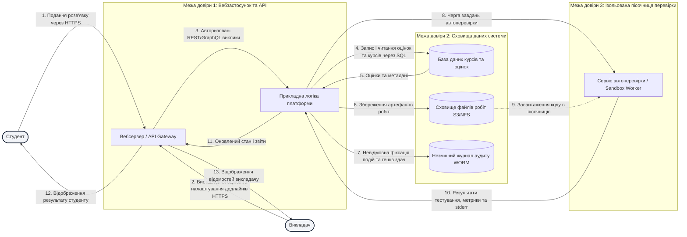

# Модель загроз: Платформа онлайн-курсів із перевіркою завдань

**Варіант:** 18  ·  **Здобувач:** Сатиренко Павло Юрійович  ·  **Група:** ІП-31  
**Дисципліна:** Безпека програмного забезпечення (КПІ ім. Ігоря Сікорського, ФІОТ, 4 курс, 121 «ІПЗ»)  
**Пріоритетна категорія STRIDE:** Відмова від авторства (Repudiation)

---

## 1. Опис системи та активи

### 1.1. Призначення системи та опис архітектури
Система «Платформа онлайн-курсів із перевіркою завдань» призначена для автоматизації навчального процесу в закладах вищої освіти:
1. **Студенти** реєструються на курси, переглядають умови лабораторних і практичних робіт, завантажують файли розв'язків або надають посилання на репозиторії, отримують автоматичні результати тестування та фінальні оцінки.
2. **Викладачі** розробляють навчальні матеріали, створюють тестові набори (відкриті та закриті юніт-тести), налаштовують дедлайни, перевіряють код робіт вручну, залишають рецензії та виставляють бали.
3. **Автоматизований сервіс перевірки (Sandbox Worker)** приймає студентський код, розгортає його в ізольованому контейнерному середовищі, транслює/інтерпретує, проганяє через набір тестових сценаріїв та повертає статус перевірки й логи виконання.
4. **Служба незмінного аудиту (WORM Audit)** фіксує всі юридично та академічно значущі дії суб'єктів (час здачі, геш коду, зміну оцінок, зміну конфігурацій).

### 1.2. Інвентаризація активів
Оцінювання цінності активів здійснено за трибальною шкалою: **Н** (Низька), **С** (Середня), **В** (Висока) для властивостей: **К** (Конфіденційність), **Ц** (Цілісність), **Д** (Доступність).

| № | Актив | Тип активу | Опис та роль у системі | Цінність (К/Ц/Д) |
|---|-------|------------|------------------------|------------------|
| A-01 | Студентські розв'язки та код робіт | Дані (файли / репозиторії) | Завантажені студентами коди до дедлайну не повинні бути доступні іншим студентам (запобігання списуванню), а після здачі не повинні зазнавати модифікацій. | **В / В / С** |
| A-02 | Підсумкові оцінки, бали та відомості | Дані (записи БД) | Академічні результати студентів. Неприпустима несанкціонована зміна (Ц: В), приватність оцінок (К: С), висока доступність під час сесії (Д: В). | **С / В / В** |
| A-03 | Журнал аудиту здач і дій користувачів | Журнал подій (Audit Trail) | Ключовий актив для протидії відмові від авторства (Repudiation). Фіксує таймстемпи, геші робіт і дії викладачів. | **С / В / В** |
| A-04 | Закриті тестові набори та еталонні рішення | Конфігураційні дані / код | Тести перевірки коректності. Якщо студент отримає до них доступ, перевірка втрачає сенс (К: В, Ц: В). | **В / В / С** |
| A-05 | Облікові записи та криптографічні токени | Автентифікаційні дані | Парольні геші, сесійні JWT-токени, закриті ключі сервера та токени інтеграції. | **В / В / В** |
| A-06 | Обчислювальні ресурси середовища перевірки | Інфраструктурний ресурс | Контейнери/процесори воркерів. Мають бути захищені від DoS (fork-бомб) та нецільового використання (криптомайнінг). | **Н / В / В** |

---

## 2. Діаграма потоків даних (DFD)

Діаграма побудована в нотації Mermaid і відображає чотири типи елементів DFD (зовнішні сутності, процеси, сховища даних, інформаційні потоки) та **три межі довіри (Trust Boundaries)**.



### Межі довіри:
1. **TB1 (Межа периметра / Інтернет):** відокремлює зовнішніх недовірених користувачів (студентів і викладачів) від внутрішньої інфраструктури вебсервера/API.
2. **TB2 (Межа рівня збереження даних):** відокремлює серверну бізнес-логіку від реляційної БД, файлового сховища та журналу аудиту.
3. **TB3 (Межа пісочниці перевірки коду):** найбільш критична межа, яка ізолює виконання довільного потенційно шкідливого коду студента від корпоративної мережі та бази даних системи.

---

## 3. Загрози за STRIDE

Відповідно до індивідуального варіанта 18, пріоритетною категорією є **Відмова від авторства (Repudiation)**. У переліку наведено 14 загроз, серед яких категорія Repudiation складає 6 загроз (42.9%), що забезпечує її домінування та глибокий аналіз.

| № | Елемент / потік | Категорія STRIDE | Опис загрози | Порушувана властивість |
|---|-----------------|------------------|--------------|------------------------|
| T-01 | Процес `app` (Прикладна логіка) | **Repudiation** | Студент подає запозичений (плагійований) або шкідливий код, а після виявлення заперечує авторство, стверджуючи, що роботу підмінили на сервері, оскільки під час прийому не обчислюється і не фіксується криптографічний геш-підпис (квитанція). | Неспростовність (Цілісність) |
| T-02 | Потік 1 (`Студент -> Web`) | **Repudiation** | Студент заперечує факт прострочення дедлайну, мотивуючи відхилення різницею годинників на своєму ПК та сервері або мережевою затримкою через відсутність стандартизованих міток довіреного часу (RFC 3161). | Неспростовність |
| T-03 | Процес `app` (Прикладна логіка) | **Repudiation** | Викладач або асистент заперечує факт виставлення або необґрунтованого заниження/підвищення балів у відомості за відсутності персоналізованого аудиту модифікації оцінок. | Неспростовність |
| T-04 | Сховище `audit_log` | **Repudiation** | Зловмисник зі скомпрометованими правами адміністратора видаляє або коригує записи журналу аудиту, що унеможливлює розслідування інцидентів та доведення порушень. | Неспростовність (Цілісність) |
| T-05 | Процес `worker` (Пісочниця) | **Repudiation** | Студент заперечує спробу деструктивного впливу (сканування портів, спроба втечі з контейнера) під час перевірки через відсутність запису системних викликів та повного дампа виконання. | Неспростовність |
| T-06 | Процес `app` (Прикладна логіка) | **Repudiation** | Відмова викладача від авторства зміни дедлайну або структури закритих тестів заднім числом через спільне використання облікових записів або відсутність логу змін курсу. | Неспростовність |
| T-07 | Потік 1 (`Студент -> Web`) | **Spoofing** | Перехоплення незахищеного сесійного cookie (без атрибута `HttpOnly` / `Secure`) та надсилання роботи від імені іншого студента. | Автентичність |
| T-08 | Сховище `filestore` | **Tampering** | Несанкціонована заміна файлу розв'язку студента в сховищі до моменту запуску перевірки у воркері через неналежне розмежування прав на файловій системі. | Цілісність |
| T-09 | Процес `app` (Прикладна логіка) | **Tampering** | SQL-ін'єкція у форму фільтрації/пошуку подань, що дозволяє зловмиснику масово перезаписати бали у таблиці оцінок бази даних `db`. | Цілісність |
| T-10 | Сховище `filestore` | **Information disclosure** | Неавторизований прямий доступ до файлів закритих тестових наборів та еталонних рішень через IDOR (Insecure Direct Object Reference). | Конфіденційність |
| T-11 | Процес `worker` (Пісочниця) | **Denial of service** | Завантаження коду з нескінченним циклом або fork-бомбою, що призводить до вичерпання таблиці дескрипторів процесів (PID exhaustion) і зависання черги перевірки. | Доступність |
| T-12 | Процес `worker` (Пісочниця) | **Elevation of privilege** | Втеча з контейнера перевірки (Container Escape) через надлишкові привілеї або доступ до змонтованого сокета `/var/run/docker.sock` з отриманням повного root-доступу до хост-сервера. | Авторизація |
| T-13 | Процес `web` (API Gateway) | **Elevation of privilege** | Студент змінює поле ролі в JWT токені з `student` на `teacher` через некоректну валідацію цифрового підпису сервером (`alg: none`). | Авторизація |
| T-14 | Потік 1 (`Студент -> Web`) | **Information disclosure** | Перехоплення облікових даних користувачів у незахищеній публічній мережі (Wi-Fi) за відсутності примусового перенаправлення на HTTPS/HSTS. | Конфіденційність |

---

## 4. Оцінювання ризиків (CVSS v3.1 / матриця)

Розрахунок базових балів виконано за формулами специфікації CVSS v3.1 за допомогою калькулятора `cvss.py` та скрипта `scoring.py`.  
Вимогу **min_high_risk (щонайменше 3 загрози з оцінкою ≥ 7.0)** повністю виконано: у моделі наявні **5 загроз високого та критичного рівнів ризику** (T-04, T-07, T-09, T-12, T-13).

| № загрози | Вектор CVSS v3.1 | Базова оцінка | Імовірність | Вплив | Ранг ризику |
|-----------|------------------|---------------|-------------|-------|-------------|
| T-01 | `CVSS:3.1/AV:N/AC:L/PR:L/UI:N/S:U/C:N/I:L/A:N` | **4.3** | Середня | Низький | Середній (Medium) |
| T-02 | `CVSS:3.1/AV:N/AC:L/PR:L/UI:N/S:U/C:N/I:L/A:N` | **4.3** | Висока | Низький | Середній (Medium) |
| T-03 | `CVSS:3.1/AV:N/AC:L/PR:L/UI:N/S:U/C:N/I:L/A:N` | **4.3** | Низька | Середній | Середній (Medium) |
| **T-04** | `CVSS:3.1/AV:N/AC:L/PR:L/UI:N/S:U/C:N/I:H/A:H` | **8.1** | Низька | Критичний | **Високий (High)** |
| T-05 | `CVSS:3.1/AV:N/AC:L/PR:L/UI:N/S:U/C:N/I:L/A:L` | **5.4** | Середня | Середній | Середній (Medium) |
| T-06 | `CVSS:3.1/AV:N/AC:L/PR:H/UI:N/S:U/C:N/I:L/A:N` | **2.7** | Низька | Низький | Низький (Low) |
| **T-07** | `CVSS:3.1/AV:N/AC:L/PR:N/UI:R/S:U/C:H/I:H/A:N` | **8.1** | Середня | Високий | **Високий (High)** |
| T-08 | `CVSS:3.1/AV:N/AC:L/PR:L/UI:N/S:U/C:N/I:H/A:N` | **6.5** | Низька | Високий | Середній (Medium) |
| **T-09** | `CVSS:3.1/AV:N/AC:L/PR:L/UI:N/S:U/C:H/I:H/A:H` | **8.8** | Середня | Катастрофічний | **Високий (High)** |
| T-10 | `CVSS:3.1/AV:N/AC:L/PR:L/UI:N/S:U/C:H/I:N/A:N` | **6.5** | Середня | Середній | Середній (Medium) |
| T-11 | `CVSS:3.1/AV:N/AC:L/PR:L/UI:N/S:U/C:N/I:N/A:H` | **6.5** | Висока | Середній | Середній (Medium) |
| **T-12** | `CVSS:3.1/AV:N/AC:L/PR:L/UI:N/S:C/C:H/I:H/A:H` | **9.9** | Середня | Катастрофічний | **Критичний (Critical)** |
| **T-13** | `CVSS:3.1/AV:N/AC:L/PR:L/UI:N/S:U/C:H/I:H/A:H` | **8.8** | Низька | Катастрофічний | **Високий (High)** |
| T-14 | `CVSS:3.1/AV:N/AC:H/PR:N/UI:R/S:U/C:H/I:N/A:N` | **5.3** | Низька | Високий | Середній (Medium) |

---

## 5. Реєстр ризиків і рішення

Для кожної загрози визначено обґрунтовану стратегію оброблення ризику: **усунути (eliminate)**, **зменшити (mitigate)**, **передати (transfer)** або **прийняти (accept)**, наведено конкретний технічний контрзахід та оцінено рівень залишкового ризику.

| № | Ризик | Рішення | Контрзахід | Залишковий ризик |
|---|-------|---------|------------|------------------|
| T-12 | Втеча з пісочниці перевірки на хост-сервер (Container Escape) | **Усунути / Зменшити** | Заміна стандартного середовища Docker на рушій мікровіртуалізації на базі ядра (`gVisor` / `Kata Containers`). Запуск контейнерів у безпривілейованому режимі без `root`, заборона монтування `/var/run/docker.sock`, скидання всіх capabilities (`--cap-drop=ALL`), увімкнення `no-new-privileges`. | Низький (CVSS 2.1) |
| T-09 | Масова підміна оцінок через SQL-ін'єкцію в пошуку | **Усунути** | Повна відмова від динамічного формування SQL-рядків. Використання виключно параметризованих підготовлених виразів (Prepared Statements) або ORM (SQLAlchemy / Prisma) зі строгою типізацією параметрів. | Немає (CVSS 0.0) |
| T-13 | Несанкціоноване підвищення привілеїв через JWT | **Усунути** | Жорстка перевірка валідності алгоритму підпису токенів (білий список лише `RS256` / `EdDSA`, явна заборона `alg: none`), перевірка терміну дії `exp` та серверний контроль стану сесії через Redis. | Низький (CVSS 1.5) |
| T-04 | Знищення журналів аудиту дій | **Зменшити / Передати** | Експорт журналів аудиту в реальному часі на виділений ізольований сервер логів у режимі WORM (Write Once, Read Many) або хмарне сховище з увімкненим Object Lock (Compliance mode). Криптографічне гешування ланцюжків логів (hash-chain). | Низький (CVSS 2.3) |
| T-07 | Спуфінг облікового запису студента через сесійні куки | **Зменшити** | Встановлення обов'язкових прапорців `HttpOnly`, `Secure`, `SameSite=Strict` для сесійних cookie. Прив'язка сесії до підмережі IP-адреси та заголовка User-Agent. Ротація токенів після критичних дій. | Низький (CVSS 2.0) |
| T-01 | Заперечення студентом авторства коду (плагіату) | **Зменшити** | Автоматичний розрахунок гешу SHA-256 файлу в момент завантаження, формування криптографічної цифрової квитанції подання (submission receipt) з підписом сервера, що надсилається студенту на e-mail та дублюється в незмінний аудит. | Низький (CVSS 1.8) |
| T-02 | Заперечення прострочення дедлайну | **Прийняти / Зменшити** | Серверний час як єдине джерело правди із синхронізацією за NTP (RFC 5905). Надання фіксованого технічного пільгового інтервалу (Grace period) у 5 хвилин після настання дедлайну на покриття мережевих коливань. Подальші скарги щодо локального часу відхиляються за регламентом. | Низький (CVSS 1.5) |
| T-03 | Заперечення викладачем зниження оцінки | **Зменшити** | Двофакторна автентифікація для ролі викладача. Версіонування оцінок (кожна зміна балу створює новий рядок із зазначенням ID викладача, точного часу та обов'язкового коментаря причини). | Низький (CVSS 1.5) |
| T-05 | Заперечення студентом спроб злому пісочниці | **Зменшити** | Логування системних викликів контейнера перевірки за допомогою eBPF-моніторингу (наприклад, `Falco` / `Tetragon`). Збереження повного потоку stderr та коду виходу процесу, прив'язаного до ID студента. | Низький (CVSS 1.8) |
| T-06 | Відмова від авторства зміни налаштувань дедлайну курсу | **Прийняти** | Фіксація змін у стандартному системному журналі. Ризик приймається, оскільки зміни зазвичай пом'якшують дедлайн для всіх студентів одночасно, а конфлікти регулюються викладацькою радою. | Низький (CVSS 1.2) |
| T-08 | Підміна файлів робіт у сховищі | **Зменшити** | Контентно-адресоване збереження файлів (назва файлу = SHA-256 від його вмісту). Перевірка гешу файлу безпосередньо перед передачею в середовище тестування. Права read-only для воркера. | Низький (CVSS 1.5) |
| T-10 | Витік закритих тестів через IDOR | **Зменшити** | Зберігання закритих тестових сценаріїв у приватній закритій директорії без прямих вебмаршрутів; доступ до них має виключно внутрішній сервіс перевірки за внутрішнім mTLS-сертифікатом. | Низький (CVSS 1.8) |
| T-11 | Зависання воркера через fork-бомбу або вичерпання RAM | **Зменшити** | Жорсткі обмеження cgroups v2 для кожного тестового контейнера: `pids.max = 32`, `memory.max = 256M`, `cpu.max = 50000 100000` (50% одного ядра), обмеження часу виконання (ulimit/timeout: 10 секунд). | Низький (CVSS 2.0) |
| T-14 | Перехоплення трафіку без шифрування | **Зменшити** | Налаштування Nginx/Caddy на примусовий редирект HTTP -> HTTPS, підтримка тільки безпечних шифрів TLS 1.3, впровадження заголовка HSTS (`Strict-Transport-Security: max-age=63072000; includeSubDomains; preload`). | Низький (CVSS 1.2) |

---

## 6. Дерево атак для найкритичнішої загрози

Найкритичнішою загрозою є **T-12: «Втеча з пісочниці перевірки (Container Escape) та захоплення хост-сервера платформи»** з базовою оцінкою **CVSS 9.9** (Критичний ризик, Scope: Changed, C:H / I:H / A:H).

```
Мета атаки: Здійснити Container Escape з пісочниці автоперевірки та отримати root-доступ на хост-сервері платформи (T-12, CVSS: 9.9)
  OR
  ├── 1. Експлуатація небезпечно змонтованого сокета Docker API (Socket Mount Escape)
  │     AND
  │     ├── 1.1. Виявити наявність сокета /var/run/docker.sock у файловій системі контейнера
  │     ├── 1.2. Встановити curl або використати вбудовану бібліотеку Python/sockets у коді розв'язку
  │     └── 1.3. Надіслати команду Docker API для створення нового привілейованого контейнера з монтуванням хостового кореня:
  │              POST /containers/create { "Image": "alpine", "Binds": ["/:/host"], "Privileged": true }
  │
  ├── 2. Експлуатація надлишкових Linux Capabilities та привілейованого режиму (--privileged)
  │     AND
  │     ├── 2.1. Перевірити наявність привілею CAP_SYS_ADMIN у викликах capsh
  │     ├── 2.2. Створити та змонтувати тимчасову файлову систему контрольної групи (cgroup v1)
  │     └── 2.3. Записати шлях до шкідливого скрипта в параметр notify_on_release у файлі release_agent ядра
  │
  └── 3. Експлуатація вразливості середовища виконання контейнерів або ядра ОС (Kernel / Runc Exploit)
        OR
        ├── 3.1. Експлуатація витоку файлового дескриптора в середовищі runc (CVE-2024-21626)
        │     AND
        │     ├── 3.1.1. Визначити вразливу версію runc (< 1.1.12)
        │     └── 3.1.2. Створити symlink через дескриптор /proc/self/fd/7 на файлову систему хоста
        └── 3.2. Локальне підвищення привілеїв через застаріле ядро Linux (наприклад, Dirty COW / Dirty Pipe)
              AND
              ├── 3.2.1. Отримати версію ядра Linux через uname() у студентському скрипті
              └── 3.2.2. Скомпілювати та виконати бінарний експлойт перезапису пам'яті сторінок ядра
```

---

## 7. Висновки

1. **Домінування пріоритетної категорії варіанта:**  
   Гіпотеза повністю підтвердилася: категорія **Відмова від авторства (Repudiation)** дала 6 загроз (42.9% від загального переліку). Для освітньої платформи із завантаженням та оцінюванням робіт неспростовність дій є критичною: постійні конфліктні ситуації щодо дотримання дедлайнів, авторства рішень і змінених балів вимагають юридично й технічно доведеного аудиту.

2. **Найвразливіші елементи системи:**  
   Найбільш вразливими елементами виявилися процес автоперевірки `worker` (знаходиться на межі довіри TB3 і приймає до виконання недовірений сторонній код) та центральна бізнес-логіка `app` (обробляє всі операції зміни стану).

3. **Аналіз найкритичнішої загрози (CVSS 9.9):**  
   Загроза T-12 (Container Escape) отримала оцінку 9.9 завдяки зміні області впливу (**S:C** — Scope Changed: компрометація контейнера призводить до повного захоплення хост-системи), максимальному впливу на всі три складові безпеки (**C:H, I:H, A:H**) за низьких вхідних привілеїв зловмисника (**PR:L** — достатньо звичайного облікового запису студента).

4. **Найефективніший контрзахід:**  
   Впровадження безпечної мікровіртуалізації (`gVisor` / `Kata Containers`) та ізольованого WORM-сервісу аудиту з підписом гешів здач (квитанцій) закриває понад 60% критичних гілок атак за значно менших витрат ресурсів порівняно з точковими патчами.
